# Arcadia Systems for MiSTer

FPGA core of the Arcadia Multi Select (Arcadia Systems / Mastertronic, 1987 - 1990: an Amiga 500 board with a ROM cage on its
expansion port: the 68000, the OCS chipset, the OnePlay BIOS, a battery-backed NVRAM, coin and start inputs), for the MiSTer.
Built on [Minimig-AGA_MiSTer](https://github.com/MiSTer-devel/Minimig-AGA_MiSTer), fixed to the A500 / OCS / NTSC
configuration, and written from MAME 0.289's `amiga/arsystems.cpp`; MAME was the oracle for everything (the ROM layout and its
scrambling, the memory map, the boot, the pictures, the inputs), and the result is checked against it in simulation and on a real
MiSTer. No ROMs or other copyrighted data are in this repository: you supply your own MAME 0.289 romsets.

## Screenshots

The title screens, as MAME 0.289 draws them. Leader Board Golf and Ninja Mission have none of their own: their high-score
boards stand in; Blastaball shows its title after a coin, Table Hockey in its attract mode.

| | | |
|---|---|---|
| 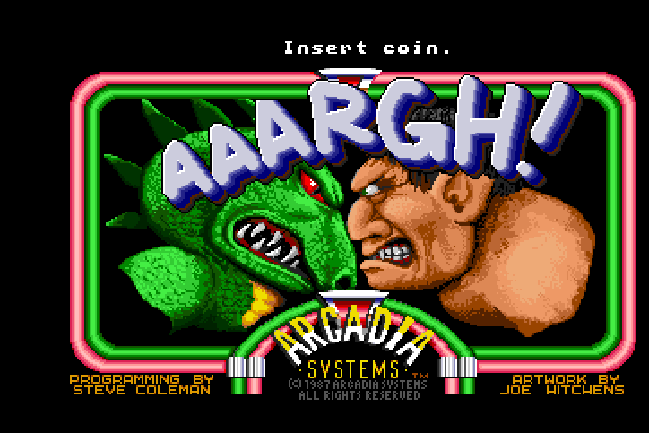 | 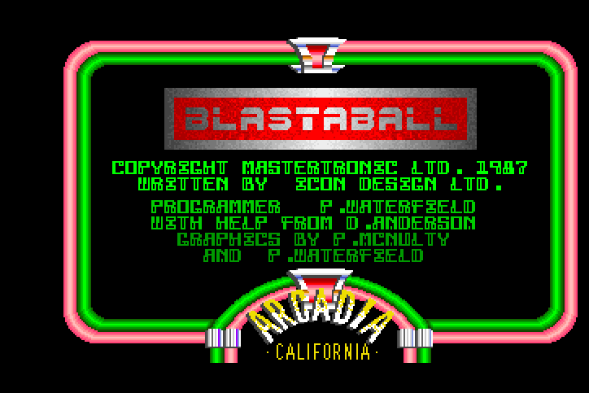 | 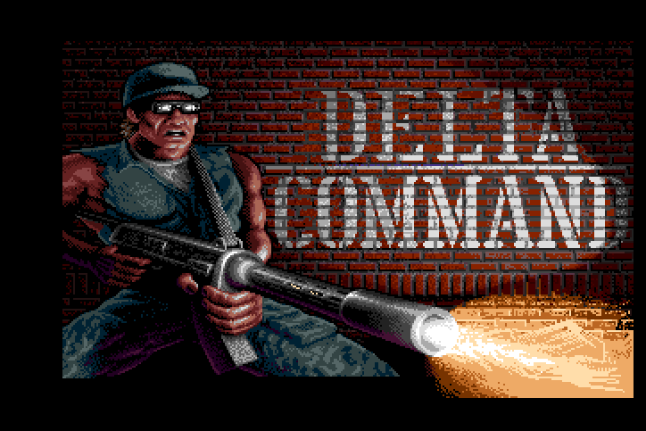 |
| Aaargh | Blastaball | Delta Command |
| 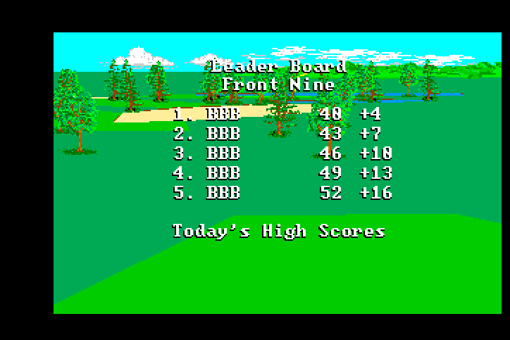 | 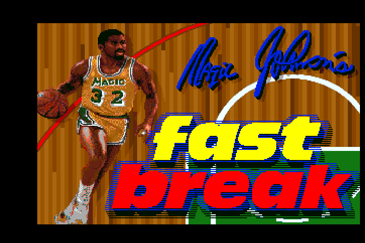 | 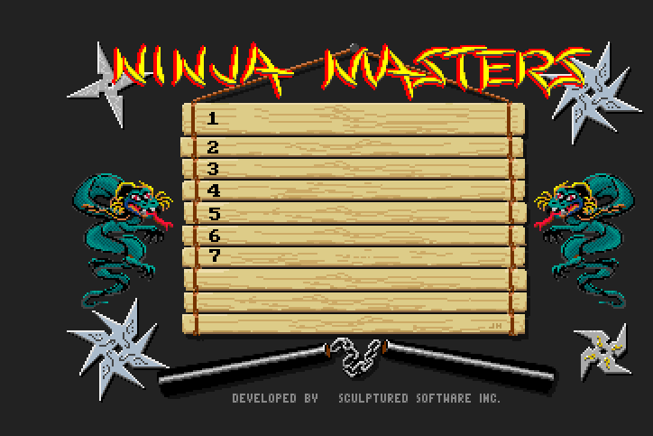 |
| Leader Board Golf | Magic Johnson's Fast Break | Ninja Mission |
| 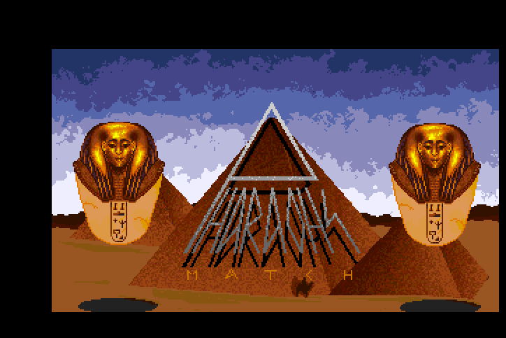 | 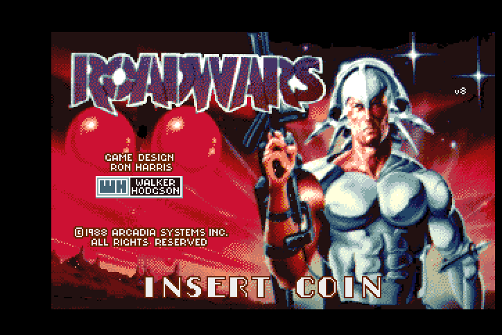 | 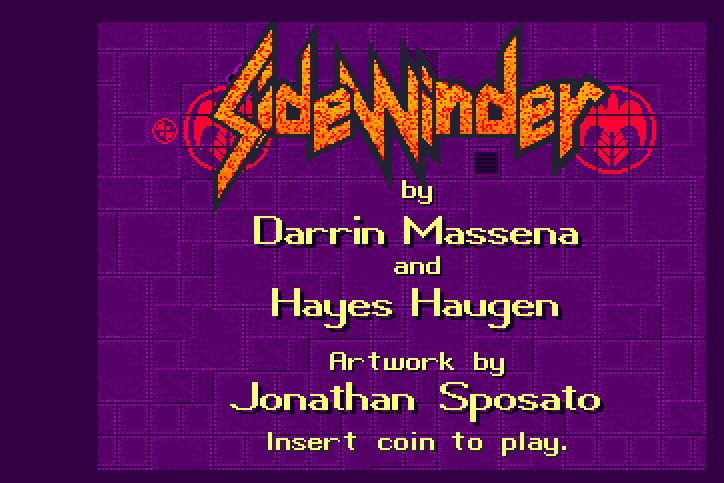 |
| Pharaohs Match | RoadWars | Sidewinder |
| 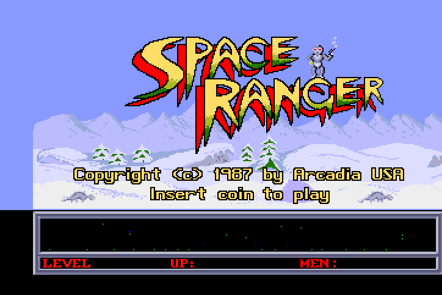 | 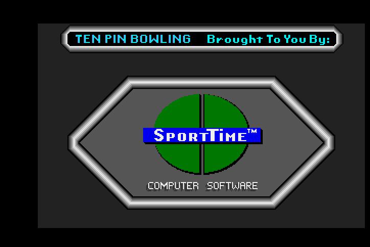 | 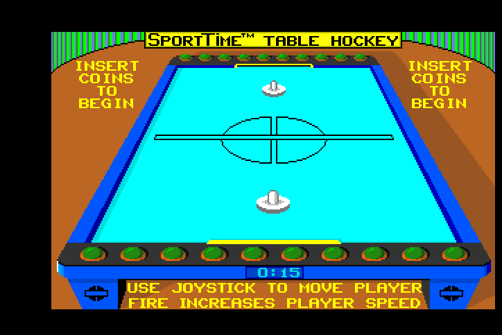 |
| Space Ranger | SportTime Bowling | SportTime Table Hockey |
|  | 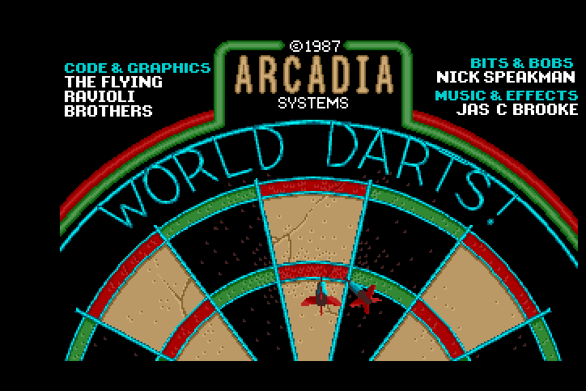 | 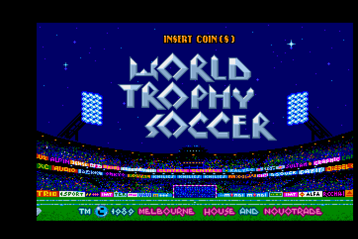 |
| Spot | World Darts | World Trophy Soccer |
| 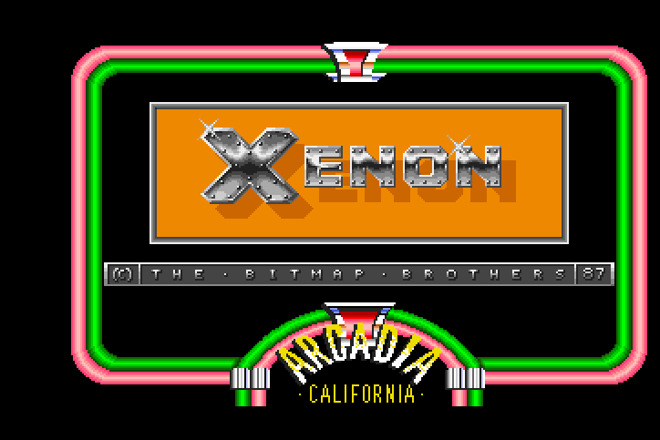 |  |  |
| Xenon |  |  |

## Install

The zip of a GitHub release unpacks over the root of the SD card. By hand:

1. Put `releases/arcadiasystems_<date>.rbf` in `/media/fat/_Arcade/cores/` and the contents of `mra/` in `/media/fat/_Arcade/`
   (the other versions of a title are in `_alternatives/_<Title>/`). Keep the RBF's name and date: MiSTer finds the core by the
   MRA's `<rbf>` name and takes the newest. Use the MRAs of the same release as the core: they name the buttons it maps and ask
   for its fast load.
2. Put your MAME 0.289 romsets in `/media/fat/games/mame/`: the game's zip and `ar_bios.zip`, which also holds the Kickstart 1.3
   ROM (no separate Kickstart file is needed). The merged sets, or the split sets with their parent zip.
3. Start the game from the Arcade menu. With a recent Main_MiSTer the 2.5 MB ROM image loads at once (**fast loading**: the MRAs
   carry `address="0x32000000"`, which makes Main_MiSTer copy the whole image into the DDR3, and the core copies it from there
   into the SDRAM); an older Main_MiSTer ignores the attribute and streams the image. Either way the core writes it straight into
   its SDRAM, a word in each 7 MHz slot. The first start of a game initialises the BIOS's NVRAM ("Initializing GCP NonVolatile
   RAM") and reaches the game after about half a minute, as on MAME.
4. **Buttons:** define them once per game ("Define buttons"); each MRA names the buttons its game uses (`-` for one it does not
   use, which MiSTer skips).

| MRA | Set | ROM zips (MAME 0.289) |
|---|---|---|
| Aaargh | ar_argh | ar_argh + ar_bios |
| Blastaball (V 2.1) | ar_blast | ar_blast + ar_bios |
| Delta Command | ar_dlta | ar_dlta + ar_bios |
| Leader Board Golf (set 1, V 2.5) | ar_ldrb | ar_ldrb + ar_bios |
| &nbsp;&nbsp;Leader Board Golf (set 2, V 2.4) | ar_ldrba | ar_ldrba + ar_ldrb + ar_bios |
| &nbsp;&nbsp;Leader Board Golf (set 3) | ar_ldrbb | ar_ldrbb + ar_ldrb + ar_bios |
| Magic Johnson's Fast Break (V 2.8) | ar_fast | ar_fast + ar_bios |
| &nbsp;&nbsp;Magic Johnson's Fast Break (V 2.7) | ar_fasta | ar_fasta + ar_fast + ar_bios |
| Ninja Mission (set 1, V 2.5) | ar_ninj | ar_ninj + ar_bios |
| &nbsp;&nbsp;Ninja Mission (set 2) | ar_ninj2 | ar_ninj2 + ar_ninj + ar_bios |
| Pharaohs Match | ar_pm | ar_pm + ar_bios |
| RoadWars (V 2.3) | ar_rdwr | ar_rdwr + ar_bios |
| Sidewinder (set 1, V 2.1) | ar_sdwr | ar_sdwr + ar_bios |
| &nbsp;&nbsp;Sidewinder (set 2) | ar_sdwr2 | ar_sdwr2 + ar_sdwr + ar_bios |
| Space Ranger (V 2.0) | ar_sprg | ar_sprg + ar_bios |
| SportTime Bowling (V 2.1) | ar_bowl | ar_bowl + ar_bios |
| SportTime Table Hockey (set 1, V 2.1) | ar_airh | ar_airh + ar_bios |
| &nbsp;&nbsp;SportTime Table Hockey (set 2) | ar_airh2 | ar_airh2 + ar_airh + ar_bios |
| Spot (V 2.0) | ar_spot | ar_spot + ar_bios |
| World Darts (set 1, V 2.1) | ar_dart | ar_dart + ar_bios |
| World Trophy Soccer (V 3.0) | ar_socc | ar_socc + ar_bios |
| Xenon (V 2.3) | ar_xeon | ar_xeon + ar_bios |

The MRAs' titles end in "(Arcadia, ...)", as MAME's. Not supported: World Darts set 2 (`ar_dart2`), a bad dump that MAME marks not
working. `tools/make_mra.py` writes the MRAs from MAME 0.289's ROM lists (read from `arsystems.cpp` by `tools/gen_sets.py`) and
checks that each builds, byte for byte, the image `tools/arcadia_rom.py` builds by MAME's loading rules, with the md5 MiSTer
computes.

## Controls

| | |
|---|---|
| Joystick | two players, each an 8-way stick and two buttons, plus Start and Coin; the buttons named in each MRA as its game calls them (below). Player 1 is the Amiga's game port 0 and player 2 port 1, as in MAME |
| Keyboard | 1 / 2 start, 5 / 6 coin, F2 service (MAME's keys). Service is on the keyboard only, so a pad cannot enter the BIOS's service mode by accident |
| Service mode | hold service when the BIOS has printed "INITIALIZATION OK", or press it during a game: the BIOS's bookkeeping and settings |

| Game | A (Button 1) | B (Button 2) |
|---|---|---|
| Aaargh | Fire | Punch |
| Blastaball | Fire | Accelerate |
| Delta Command | Fire | Special Weapon |
| Leader Board Golf | Select Club | Top View |
| Magic Johnson's Fast Break | Shoot / Jump | Pass / Switch |
| Ninja Mission | Punch / Kick | Sword |
| Pharaohs Match | Select | Cancel |
| RoadWars | Fire | - |
| Sidewinder | Fire | - |
| Space Ranger | Fire | Net |
| SportTime Bowling | Throw | Throw |
| SportTime Table Hockey | Speed Up | Speed Up |
| Spot | Select | - |
| World Darts | Throw | - |
| World Trophy Soccer | Kick | Switch Player |
| Xenon | Fire | Transform |

The names are the games' own where they show their controls (Space Ranger's, Aaargh's, Ninja Mission's, Blastaball's,
Leader Board's, Fast Break's and Soccer's instruction or control screens), and each button was pressed on its own in MAME 0.289.
Leader Board swings with the joystick alone; Bowling and Table Hockey take either button (their code reads button 1 or 2).

## OSD options

| Option | Values | |
|---|---|---|
| Aspect ratio | Original, Full Screen, [ARC1], [ARC2] | the HDMI picture's shape: 4:3, the whole screen, or MiSTer.ini's custom ratios |
| Scale | Normal, V-Integer, HV-Integer, Narrower HV-Integer, HV-Integer+ | integer scaling on the HDMI scaler (the framework's video_freak; the 15 kHz analog output is not affected): the largest whole multiple of the picture's height that fits the screen, with the aspect ratio's width (V-Integer) or a whole multiple of the picture's width (Narrower: the multiple below the aspect ratio's width, HV-Integer+: the one above it while it fits, HV-Integer: the nearer). With Full Screen the integer modes use the screen's own proportions |
| Scandoubler Fx | None, HQ2x, CRT 25 / 50 / 75 % | None: the 15 kHz picture; the others double the lines to 31 kHz, smoothed (HQ2x) or with darkened scanlines. MiSTer.ini's `forced_scandoubler` turns the doubling on too. The core's horizontal blank toggles on every line, the vertical blank's included, as the scandoubler needs |
| CRT Adjust (a page of its own) | Off / On, H-Size, H-Position, V-Shift | the size and place of the picture on a 15 kHz analog output without the monitor losing its lock, with rmonic79's [MiSTer-CRT-Adjust](https://github.com/rmonic79/MiSTer-CRT-Adjust) (`modules/crt-adjust`): H-Size -16..+6 (a step is 1/64 of a dot), H-Position -48..+32 lores dots, V-Shift -16..+15 lines (positive moves it down). It does nothing while the scandoubler is in use, and the HDMI picture follows it: leave it Off for HDMI |
| Audio filter | A500 (power LED), Off, On | an A500 always filters at ~4.4 kHz and adds a ~3.3 kHz filter while the power LED is bright, which the software switches. A500 lets the software switch it, as on the board; Off and On fix it |
| Stereo mix | None, 25%, 50%, 100% | Paula's channels are hard left (0, 3) and hard right (1, 2); the mix blends each side into the other, 100% is mono |
| DSW1 1 | Reset, Set | the board's DIP switch (CIA-A port B bit 0), as MAME names it; its use is not documented. Reset is MAME's default |
| Autosave NVRAM | On, Off | On: when the OSD opens after the game has changed its NVRAM, MiSTer saves it to the SD card |
| Save NVRAM | | the same at once |
| Reset | | restarts the machine: Kickstart, the BIOS and the game's load from the ROM board (the ROMs stay in memory; the NVRAM is kept) |

MiSTer keeps the NVRAM (the BIOS's bookkeeping and settings, the high scores) on the SD card as a `.nvm` file (the MRAs'
`<nvram index="4" size="16384"/>`, Aaargh's 4096) and loads it with the game; its bytes are MAME's `nvram/<set>/nvram`. Without a
saved file the NVRAM starts cleared and the BIOS initialises it, as on MAME.

CRT Adjust's room: a 320-dot picture (the games' usual display window) starts about 93 lores dots after the hsync pulse and ends
about 41 before the next. H-Size up to +6 keeps it whole; H-Position moves it as far as the room on either side, past it the
picture's edge is cut (by the hsync pulse on the left, the line's end on the right). The frame's picture area (241 of 263 lines)
leaves 22 lines of vertical blank: past V-Shift +3 the bottom border's last lines move into the next frame's vertical sync,
which a CRT does not show.

## Status

**Verification.** MAME 0.289 is the reference. In simulation (Verilator): every MRA builds, byte for byte, the image of MAME's
loading rules (22 sets); the loader leaves the memory word for word as an independent computation of the layout and the
unscrambling (streamed and fast loads, on the MiSTer top level); the whole machine from power-on with a blank NVRAM runs like
MAME: Kickstart 1.3, the OnePlay BIOS's resident strap and warm reboot on MAME's frames, the OnePlay screen pixel for pixel,
Space Ranger's load, title, coin, credit screen and scripted play (the same scenes and score), Aaargh's title; the MiSTer top
level in 26 video modes (the scandoubler, CRT Adjust, Scale) with a vertical sync every frame and the pictures of the 15 kHz
output. `docs/status.md` has the measured results and how to repeat them, `docs/hardware.md` the hardware as MAME describes it
and how the core maps it.

**On a real MiSTer** (the owner's):

* **Release 20261021**, its first build: every game loads and plays.
* Its rebuild, with fast loading, CRT Adjust, the five Scale modes, the button names and service off the pad: verified in
  simulation, not yet on the hardware.

**Known differences from MAME**

* MAME finds a genlock and the core does not. Kickstart's test (`$FCB008`) sets BPLCON0's external sync and checks whether the
  beam counter stops; it does on a real A500 and in Minimig, not in MAME, so MAME's copper lists carry `$0102` in BPLCON0 and the
  core's `$0200`, as a real Arcadia's would. The picture is the same.
* The coin counters follow MAME's model (two 2-bit counters taken down by port B writes); the real coin hardware is not
  documented.
* Leader Board Golf's 4-way joystick (MAME's `PORT_4WAY`) is not enforced.
* MAME keeps the ROM board switch across a soft reset; the core sets it back to "in".

## Video and sound

The machine clock is 28.636 MHz (MAME's `CLK_28M_NTSC`), the 68000 at 7.159 MHz. Minimig's PLL is built for PAL and reconfigured
to NTSC as soon as the machine reports NTSC, right after power-on; the timing constraints add the 0.92 % to the setup checks. NTSC
frame: 263 lines of 227 colour clocks, 59.958 Hz; the picture area is 241 lines. Without the scandoubler the dots go out at
28 MHz (Minimig's), with it at the frame's own resolution (7 MHz lores, 14 MHz hires), on a 57.27 MHz video clock. Sound:
Paula's four channels, two left and two right, through the A500's filters (a fixed ~4.4 kHz low pass and the ~3.3 kHz one the
power LED switches).

## Build

Quartus Prime Lite **17.0.2** (the version MiSTer's framework needs):

    quartus_sh --flow compile ArcadiaSystems        -> output_files/ArcadiaSystems.rbf

The release's RBF is `releases/arcadiasystems_<date>.rbf` with its fitter and timing summaries. `python3 tools/package.py` writes
the release zip (`dist/ArcadiaSystems_MiSTer_<date>.zip`, the SD card's structure, no ROMs) from `releases/` and `mra/`;
`python3 tools/make_mra.py <romdir>` writes the MRAs.

## Simulation and tools

Verilator benches in `sim/` (run in WSL with Verilator 5):

    sim/run_sys.sh <image> <frames> <out> [-snapevery N -sched FILE -checkload ...]   the whole machine from power-on
    sim/emu/run_emu.sh <image> [frames] [out]                                          the MiSTer top level (FAST=1 fast load)
    sim/emu/run_modes.sh <image> <saved model> <out>                                   26 video modes from a saved model

The machine bench takes scripted inputs (`-sched`, as `sim/sched_play.txt`) and checks the loader's work (`-checkload`). The top
level's bench runs `ArcadiaSystems.sv` itself with hps_io, the PLL and the SDRAM controller stubbed and the framework's video
path real; it saves and restores the whole model (`SAVEAT` / `SAVE`, `RESTORE`), so the video modes start from the OnePlay
screen. `tools/arcadia_rom.py` builds a set's ROM image, `tools/mame_dump.sh` runs MAME headless with `tools/lua/arcadia_dump.lua`
(snapshots, chip RAM, the same scripted inputs), `tools/cmp_frame.py` compares the bench's pictures with MAME's. MAME's captures,
the images and the benches' pictures go to a scratch folder `work/` next to the repository (never committed).

## Repository layout

| | |
|---|---|
| `ArcadiaSystems.sv`, `ArcadiaSystems.qsf`, `.qpf`, `.sdc`, `files.qip` | the MiSTer top level (derived from Minimig's `Minimig.sv`: OSD, inputs, the ROM loader, fast loading, the NVRAM file, audio) and the Quartus project |
| `rtl/` | the A500 with the Arcadia board (`arcadia_amiga.v`, derived from Minimig's `minimig.v`), the board's NVRAM, ROM board switch, coin counters and CIA-A port B (`arcadia_board.v`), the ROM loader (`arcadia_loader.v`), fast loading (`arcadia_fastload.v`), the video path with CRT Adjust and Scale (`arcadia_video.sv`), the PLL |
| `modules/` | other people's cores, with their licences and the local changes (`modules/VENDOR.md`): Minimig-AGA, rmonic79's CRT Adjust |
| `sys/` | the MiSTer framework |
| `mra/` | the MRAs: one a title in the folder, the other versions in `_alternatives/_<Title>/` |
| `releases/` | the RBF of the release with its fitter and timing summaries |
| `docs/` | `status.md` (results and how to repeat them), `hardware.md` (the hardware and how the core maps it), the title screens |
| `tools/`, `sim/` | sets table, ROM-image builder, MRA writer, MAME scripts, benches |

## Credits

* **MAME** (the Arcadia driver by Ernesto Corvi and Mariusz Wojcieszek, and the Amiga chipset; BSD-3-Clause): the hardware
  knowledge and the oracle for every comparison.
* **Minimig**: Dennis van Weeren, with the Minimig-AGA and MiSTer work of Jakub Bednarski, Sascha Boing, Rok Krajnc, Alastair M.
  Robinson, Alexey Melnikov (Sorgelig) and the other contributors named in the sources (GPL-3.0-or-later; `modules/minimig`).
* **Jorge Cwik** ([fx68k](https://github.com/ijor/fx68k), GPL-3.0), **rmonic79 / Umberto Parisi**, with Andrea Bogazzi
  ([MiSTer-CRT-Adjust](https://github.com/rmonic79/MiSTer-CRT-Adjust), GPL-3.0-or-later).
* **plasticbugs** (`tools/mra_build.py`, from analogue-pocket-gaiapolis, GPL-3.0): the MRA assembly and md5 check.
* **The MiSTer framework** (Sorgelig and contributors); fast loading, Scale and CRT Adjust follow the owner's other cores
  (Monster Maulers, Violent Storm, Rabbit).

## Licence

GPL-3.0-or-later (`LICENSE`); vendored modules keep their own licences (`modules/VENDOR.md`).
